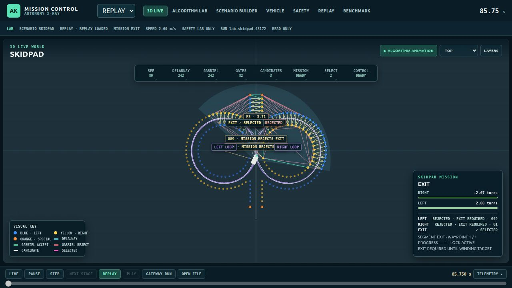
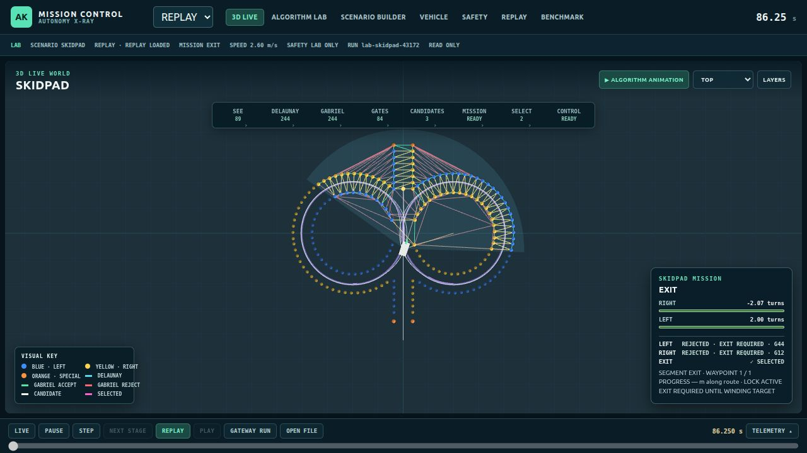
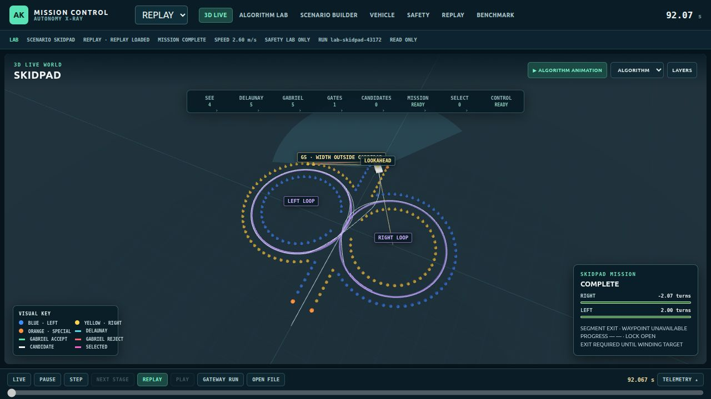
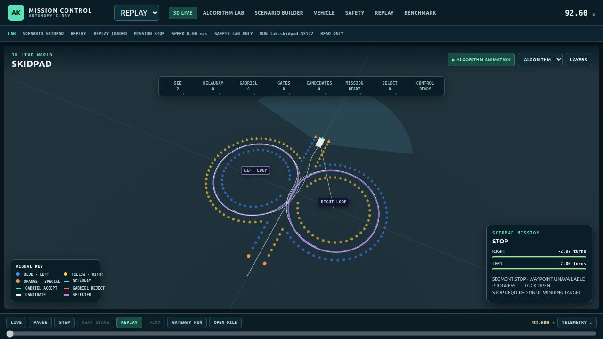
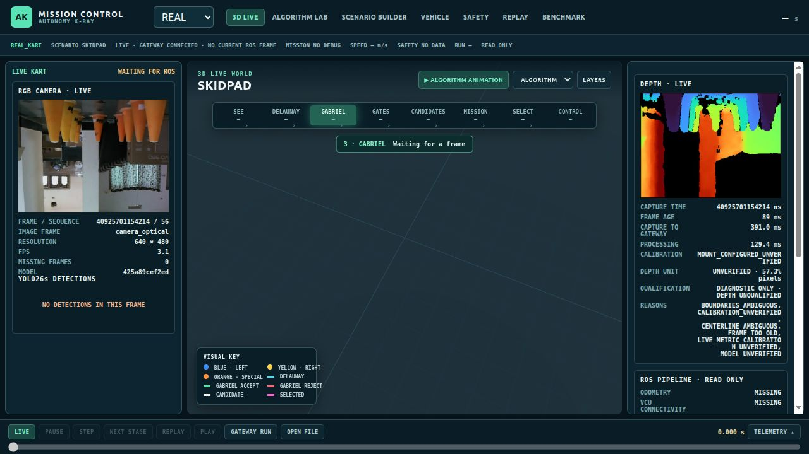
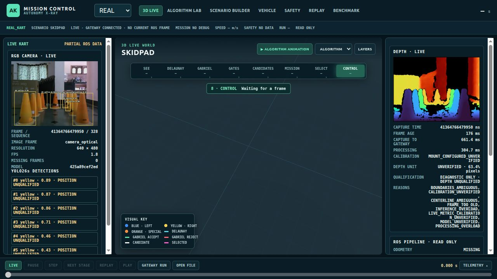

# AutoKart RC-05 end-route correction and RC-07 dashboard validation

Date: 2026-10-16. Scope: `/home/mark1/Desktop/autonomous_kart`. Verdict: **software correction demonstrated in nominal/noisy synthetic cases; vehicle release NO-GO.** All tests here are stationary software, browser or simulated ROS tests. No ESP32 command, flash, actuator operation or vehicle start was performed. `vehicle_authorized=false` throughout.

## 1. Investigation and confirmed causes

The saved pre-edit `LabSkidpad.ts` and deterministic replay reproduce the reported anomalous line. At EXIT, the mission filter admitted a Gabriel gate midpoint on the side of a loop because it only required `abs(x) < width` and positive y. The candidate ranker selected `(2.827, 6.082)` m from a pose near the crossover `(-0.337, -2.280)` m. That straight connector passes 0.494 m from a cone center, inside a 0.6 m half-width proxy. This is **invalid planned EXIT geometry**, not merely a rendering artifact. The selected path and rendered lookahead had the same endpoint at that instant.

A second defect occurred at the terminal state. The old LAB kept `lastTarget` when the selected path disappeared. Its final frame reported `COMPLETE`, 2.6 m/s, an empty selected path and a ghost LOOKAHEAD at `(0, 13.059)` m. The corrected terminal frame is `STOP`, zero speed, empty path and null lookahead. The normal mission branch cursor now rejects targets with backwards progress and resets only on a valid branch transition; the crossover remains on the active branch. ROS exit planning already uses a distinct observed exit-centerline segment and holds without it. The gateway now suppresses a control lookahead unless the current published path exists and the target lies within 0.75 m of that path.

The established Delaunay, Gabriel, Pure Pursuit and circle-fit implementations were preserved. The LAB fix narrowed EXIT gate eligibility to observed midpoints in the central corridor (`abs(x) < 0.25 × configured track width`); it did not invent an unobserved exit gate. The ROS planner's output is diagnostic only.

## 2. Before/after route evidence

Coordinates are in the LAB world frame, metres. The first EXIT samples occur at different times because the corrected route has a different trajectory. Both are deterministic synthetic replays with default seed 43172.

| Measurement | Saved pre-edit | Corrected |
|---|---:|---:|
| First EXIT pose | `(-0.337, -2.280)` at 85.75 s | `(0.167, -2.492)` at 86.25 s |
| Selected EXIT/lookahead endpoint | `(2.827, 6.082)` | `(0.000, 7.059)` |
| Closest cone center to first EXIT connector | 0.494 m | 1.500 m |
| Final state/time | COMPLETE at 92.067 s | STOP at 92.600 s |
| Final pose | `(0.063, 13.034)` | `(0.022, 12.837)` |
| Final speed/lookahead | 2.6 m/s / `(0, 13.059)` | 0 m/s / null |
| Final right/left winding | -2.071 / 1.996 turns | -2.074 / 2.001 turns |
| Minimum sampled cone-center distance | 0.226 m | 0.944 m |
| Minimum sampled clearance from 1.6 × 1.2 m proxy rectangle to a cone center | 0 m | 0.315 m |
| Maximum same-branch lookahead jump at 0.25 s sampling | 13.938 m | 1.000 m |
| Maximum sampled steering-request step at 0.25 s sampling | 0.245 rad | 0.223 rad |

The [coordinate and scenario record](skidpad_live_evidence/lab_before_after_coordinates.json) contains transition times, first EXIT path coordinates, final-left samples, min-clearance locations, the 0.12 m observation-noise case and the 15% cone-dropout case. The route still uses a simplified LAB kinematic model. The rectangle is an explicit **proxy**, not a surveyed vehicle footprint; cone radii and as-built steering limits are unqualified. The simulated 0.12 m noise case also reached STOP, with 0.806 m minimum cone-center distance and 0.139 m proxy rectangle clearance. The 15% dropout LAB case remained in RIGHT_LOOPS at 160 s and intersected a cone center (minimum 0.040 m). It is an open acceptance failure, not a passed missing-cone case.

The software-only ROS crossover Hermite segment sampled at its reference topology had maximum discrete curvature 0.151 m⁻¹, implying 0.157 rad kinematic steering for an assumed 1.05 m wheelbase. This does not certify the as-built steering envelope or rate. The LAB requested steering is bounded by 0.58 rad, but no measured steering response exists.

### Browser views of the actual existing dashboard

All four screenshots below are from file replay in the existing `phase_sim` browser, explicitly labeled REPLAY/LAB. The line, target and kart trail are rendered from the replayed MissionFrame, not separately drawn comparison art.

| Original EXIT | Corrected EXIT |
|---|---|
|  |  |

| Original terminal | Corrected terminal |
|---|---|
|  |  |

The card shows segment, active waypoint (when a path exists), winding and target progress when available. The viewport distinguishes the planned path, selected lookahead and actual simulated trail. The planned connector's cone clearance and the executed trajectory's clearance were calculated separately above.

## 3. ROS mission and fault checks

The fresh synthetic ROS probe used the actual `autokart_mapping` and `autokart_planner` nodes on an isolated ROS domain. It sent 169 timestamped samples and observed `RIGHT_1 → RIGHT_2 → TRANSITION → LEFT_1 → LEFT_2 → EXIT → STOP_PENDING → STOP`; counters ended at right=2, left=2. EXIT produced `EXIT_PATH_CANDIDATE`, then `STOP_CANDIDATE`, HOLD without stop feedback, and STOP with feedback. It reported 165 valid diagnostic path samples and `vehicle_authorized=false`: [probe result](skidpad_live_evidence/ros_full_route_probe_final.log). These cone and odometry messages were synthetic; the test is not a physical route replay.

Focused regression tests cover final-left target monotonicity, active-branch rejection, central EXIT selection, connector and trajectory cone-center clearance, final path endpoint/no-wrap/STOP, noisy cones, missing topology, stale odometry, slight EXIT pose deviation, backwards progress, wrong branch, terminal feedback and a blocked braking corridor. The ROS planner holds with no observed topology or fresh pose. The LAB 15% dropout failure described above remains unresolved.

## 4. Existing live dashboard and camera path

The existing `phase_sim` frontend consumes the existing read-only `autokart_dashboard_gateway`. The gateway pairs RGB and depth using one capture stamp, image frame and dimensions, bounds image storage, expires pairs after 1 s and transports published YOLO metadata, confidence/class, calibration status, source and processing latency. RAW16 depth is displayed as an unqualified preview. The geometry viewport uses published observed `odom` cones, Delaunay/Gabriel edges, gates, centerline/boundaries, planner path and lookahead with source, frame and expiry checks. The dashboard distinguishes LIVE, REPLAY, SIMULATION and LAB and clears stale/mismatched data. It displays camera/ROS availability, mission/laps, path validity, odometry, lookahead, fault/safety and VCU status without substituting simulation for REAL.

An actual browser session against the local gateway's **SIMULATION** source displayed 6 observed cones, 9 Delaunay and 9 Gabriel edges, 3 provisional gates, synthetic RGB/depth and ROS diagnostics. A 25-poll synthetic API capture measured mean receive rate 4.37 fps, frame age 101.6 ms, capture-to-gateway delay 230.2 ms, and published processing time 6.28 ms: [API measurements](skidpad_live_evidence/ros_browser_api_probe.json). These are laptop/synthetic measurements, not HP60C/YOLO26s target-Pi performance. [Synthetic camera/ROS browser](skidpad_live_evidence/dashboard_simulated_camera_ros.png), [observed geometry browser](skidpad_live_evidence/dashboard_simulated_observed_geometry.png), [stale odometry clearing](skidpad_live_evidence/dashboard_stale_odom_cleared.png), [REAL/SIM source mismatch](skidpad_live_evidence/dashboard_real_source_mismatch.png).

An initial REAL gateway/browser session had no camera or odometry and correctly showed `CAMERA DISCONNECTED`, `WAITING FOR ODOMETRY`, `CONTROLLER UNAVAILABLE` and `VCU MISSING`: [initial REAL no-hardware browser](skidpad_live_evidence/dashboard_real_no_hardware.png). The final rebuilt gateway at `http://127.0.0.1:18768/` ran on isolated ROS domain 95; its [initial HTTP response](skidpad_live_evidence/real_gateway_final_api.json) confirmed `REAL_KART`, LIVE, missing odometry/camera and `vehicle_authorized=false`, and its [initial browser view](skidpad_live_evidence/dashboard_real_final_no_ros.jpg) distinguished a connected gateway from a missing current ROS frame. This isolated endpoint is read-only and is not connected to a target-Pi ROS domain.

The HP60C USB interface (`3482:6723`) then appeared on this host. The existing vendor bridge produced paired 640 × 480 LIVE RGB/RAW16 depth with matching sequence numbers after one transient `CALIBRATION_UNAVAILABLE` warmup frame: [SDK probe](skidpad_live_evidence/hp60c_valid_frame_probe.log). The first ROS live trial exposed two integration defects: the perception node halted on that transient warmup error, and a status-only wall-clock error stamp occupied the gateway image buffer ahead of the camera's monotonic capture stamps. The minimal correction keeps the sole existing camera owner alive while reporting invalid warmup status, latches a fault if an established stream is lost, and stores unmatched status separately from image frames. No camera acquisition process was duplicated. The existing ROS perception node was launched in LIVE mode with the configured YOLO26s ONNX model; the gateway then displayed actual LIVE RGB, depth preview and source-tagged ROS perception status in the existing dashboard:

Across [25 actual API polls at the default thread setting](skidpad_live_evidence/hp60c_live_api_probe.json), 25 had paired camera frames and 17 distinct frame IDs. Mean received rate was **2.59 fps**, frame age **200 ms**, capture-to-gateway delay **434 ms**, and published processing time **152 ms** on this host. A restart with `OPENCV_FOR_THREADS_NUM=2` reduced CPU use but worsened timing ([2-thread trial](skidpad_live_evidence/hp60c_live_threads2_api_probe.json)). A six-thread trial yielded [25/25 paired frames, 20 distinct IDs, 3.07 fps, 148 ms mean frame age, 361 ms mean capture-to-gateway delay and 111 ms mean processing time](skidpad_live_evidence/hp60c_live_threads6_api_probe.json). Its first viewed scene had zero detections. The model hash matched `models/yolo26s/best.onnx`. All 25 metric status samples were invalid, with reasons including unverified calibration/model and some frames too old; RAW16 depth stayed `depth_qualified=false`.

A longer final live session exposed a related clock-domain defect: the first warmup error's wall-clock diagnostic stamp could outrank later HP60C monotonic stamps in the gateway health store, leaving perception marked STALE while images continued. The perception node now stamps LIVE errors with host monotonic time. The focused [ROS adapter tests](skidpad_live_evidence/ros_perception_tests_clock_final.log) passed 4 after a fresh [perception overlay build](skidpad_live_evidence/ros_perception_clock_rebuild.log). The rebuilt gateway/browser then showed perception CURRENT with actual HP60C RGB and depth. With cone-shaped objects in view, the existing YOLO26s published boxes, classes and confidences. The dashboard now hides candidate metre distances when depth and per-detection validation are unqualified:

In a subsequent [20-poll actual API sample](skidpad_live_evidence/hp60c_live_boxes_final_api_probe.json), 18 polls contained detections, 13 distinct frames were seen, and perception health was CURRENT on 20/20 polls. Mean receive rate was **2.2 fps**, capture-to-gateway delay **512 ms**, processing time **231 ms**, and displayed frame age **319 ms**. This later load was slower than the earlier six-thread trial and included `FRAME_TOO_OLD`/overload reasons. All 20 depth and metric qualifications remained false. Box/class accuracy has not been measured against labels, and no qualified cone coordinates were published. ROS odometry, mapping, planner and VCU remained missing, and the browser correctly kept its world route empty. Camera absence and gateway reconnection were exercised in software/browser tests and across process restarts; physical HP60C unplug/replug was not. These timing numbers are host measurements, not target-Pi qualification.

## 5. Changed files and verification

| Area | Exact files edited or added | Purpose |
|---|---|---|
| LAB route and frontend | `phase_sim/src/mission/LabSkidpad.ts`, `MissionControl.tsx`, `MissionScene.tsx`, `RosLivePanel.tsx`, `schema.ts`, `useMissionData.ts`, `mission.css`; `phase_sim/src/test/lab.test.ts`, `skidpad-end-route.test.ts` | Branch cursor, central EXIT gate, terminal STOP, route/trajectory and live diagnostics display, regression checks |
| ROS perception/mapping/planning | `kart/ros2_ws/src/autokart_nodes/autokart_perception/autokart_perception_ros/node.py`, `autokart_perception/test/test_ros_adapter.py`; `autokart_mapping/autokart_mapping/node.py`, `autokart_mapping/test/test_mapping_adapter.py`; `autokart_planner/autokart_planner/mission.py`, `node.py`, `test/test_mission_adapter.py`; `autokart_nodes/test/ros_straight_pipeline_probe.py`, `ros_skidpad_route_probe.py` | Published status/observed exit corridor, separate EXIT route, branch/feedback gates, recoverable camera warmup and ROS probes |
| Gateway/bringup | `kart/ros2_ws/src/autokart_dashboard_gateway/autokart_dashboard_gateway/core.py`, `camera_feed.py`, `gateway.py`, `test/test_core.py`, `test/test_live_gateway.py`, `package.xml`; `kart/ros2_ws/src/autokart_bringup/launch/rc03_rc05_diagnostics.launch.py` | Read-only camera and ROS transport, source/freshness/target validation, launch parameters |
| Contracts and release | `docs/DASHBOARD_DATA_CONTRACT.md`, `docs/RELEASE_REPORT.md`, this report and `docs/skidpad_live_evidence/` | Data provenance, measured evidence, limits and recovery |

| Check | Before this task's final edits | Final evidence |
|---|---:|---:|
| `phase_sim` Vitest | 33 passed | [35 passed](skidpad_live_evidence/phase_sim_tests_clock_final.log), plus [3 focused route tests](skidpad_live_evidence/skidpad_regression_final.log) after connector-clearance assertion |
| Focused ROS Python tests | 26 passed | [32 passed combined](skidpad_live_evidence/ros_python_tests_final.log), including [16 gateway tests](skidpad_live_evidence/gateway_tests_live_final.log) and [4 ROS perception tests](skidpad_live_evidence/ros_perception_tests_live_final.log) after camera recovery changes |
| Phase 1 perception | 140 passed | [140 passed](skidpad_live_evidence/perception_tests_final.log) |
| Kart suite | 150 passed | [150 passed](skidpad_live_evidence/kart_tests_final.log) |
| Frontend build | passed | [passed](skidpad_live_evidence/phase_sim_build_clock_final.log); existing 917 kB JS chunk warning |
| Changed ROS packages | previous overlay build passed | [4 packages built](skidpad_live_evidence/ros_rebuild_final.log) in fresh temporary overlay; [perception and gateway rebuilt](skidpad_live_evidence/ros_live_camera_rebuild.log) for the live trial; [perception rebuilt again](skidpad_live_evidence/ros_perception_clock_rebuild.log) for the clock correction; colcon warned its pytest module was unavailable, so direct Python tests above are the counted results |
| Full 2R/2L ROS sequence | passed earlier | [169 samples, STOP](skidpad_live_evidence/ros_full_route_probe_final.log) |

An initial final-suite attempt from the wrong working directory could not import `kart_sim`; the corrected run from `kart/` passed 150. An initial ROS build reused an incompatible CMake symlink build cache; the fresh overlay built the four changed packages. Neither setup attempt is counted as a product regression. Test logs remain under the evidence directory.

## 6. Remaining acceptance limits and recovery

- **Unresolved LAB missing-cone behavior:** 15% dropout can continue on loop fallback, fail the mission and intersect cones. The isolated ROS planner does hold when topology or pose is invalid; this does not resolve the LAB limitation.
- No surveyed HP60C RAW16 scale/registration/extrinsics, measured box/class accuracy, qualified metric cone detection, target-Pi runtime benchmark, measured VCU link, independent stop chain, as-built vehicle dimensions or steering-rate envelope. Live RGB/depth and YOLO boxes were observed, but they are diagnostic only; these gaps block vehicle release and any claim of live autonomy readiness.
- Synthetic cone centers and a proxy rectangle do not prove physical cone clearance. The ROS crossover/exit path is a read-only candidate, not an executed physical trajectory.
- The pre-edit rollback directory is `/home/mark1/Desktop/AutoKart_skidpad_live_dashboard_rollback_2026-10-16/`; verify its `SHA256SUMS` and follow its `ROLLBACK.md`. It contains 14 saved original files. Some RC-05 ROS source files lacked a pre-edit copy, so a complete automatic rollback of those files is **not** available; their current hashes are recorded in [POST_SHA256SUMS](skidpad_live_evidence/POST_SHA256SUMS). Preserve them before any further change.

**Release decision:** NO-GO for vehicle operation. The end-route display and nominal synthetic EXIT defect are corrected and regression-tested; missing-cone LAB behavior, real sensor qualification, physical safety and vehicle behavior remain open. This work was validated by one agent, not an independent safety reviewer.
